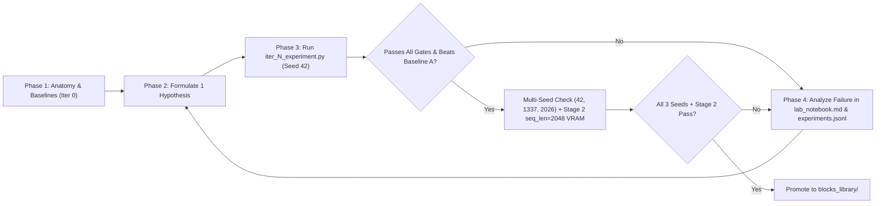

# Implementation Plan: Backprop-Free O(1)-Depth LoRA Knowledge Injection on SmolLM2-360M-Instruct

## Goal Description

Design and run an iterative scientific R&D system in `./smollm_nobackprop_lab` (`/content/smollm_nobackprop_lab`) on the active **Tesla T4 GPU** (15,360 MiB VRAM, CUDA 13.0, PyTorch `2.14.1+cu130`, `transformers 5.22.1`, `peft 0.21.2`) to discover, verify, and promote algorithms that synthesize rank $r \le 16$ LoRA adapters for **`HuggingFaceTB/SmolLM2-360M-Instruct`** (32 layers, $d = 960$, $d_{\text{ff}} = 2560$, 15/5 GQA heads, 8192 context) that:
1. Inject $N = 25$ synthetic counterfactual facts simultaneously into one LoRA without full-model backpropagation (backbone forward passes strictly under `torch.no_grad()`, $O(1)$ activation memory over model depth).
2. Achieve **Paraphrase Generalization Accuracy $\ge 75\%$** (not merely verbatim memorization).
3. Pass all hard retention and locality gates:
   - Held-out `HuggingFaceTB/smol-smoltalk` forward KL $D_{\mathrm{KL}}(P_{\text{base}} \| P_{\text{edited}}) \le 0.05$
   - General QA / chat retention $\ge 95\%$ of base model
   - Unedited synthetic sibling locality degradation $\le 2\%$
4. Synthesize in $\le 20\text{s}$ per batch of 25 facts, achieve **Stage 2 Long-Context (`seq_len=2048`)** activation VRAM overhead $\le 0.25\times$ Baseline A's overhead, beat Baseline A (5-step full-backprop LoRA) across 3 deterministic seeds (`42, 1337, 2026`), and promote verified modules to `blocks_library/`.

Environment inspection confirmed:
- GPU: `Tesla T4` (15 GiB VRAM), System RAM: 12 GiB (11 GiB available, 0 swap — requiring compact/chunked CPU tensor handling).
- `HuggingFaceTB/SmolLM2-360M-Instruct` (`LlamaForCausalLM`, tied embeddings, native `bfloat16` config, `<|im_start|>`/`<|im_end|>` chat template) and `HuggingFaceTB/smol-smoltalk` (`train`/`test` splits with `messages`) are accessible.

---

## User Review Required

> [!IMPORTANT]
> **Precision Regime on Tesla T4 (`float16` vs `bfloat16`)**: Although `SmolLM2-360M-Instruct` specifies `bfloat16` in `config.json`, the Tesla T4 (Turing SM 7.5) lacks native BF16 Tensor Cores and emulates `bfloat16` slower than native `float16`. Our plan loads the backbone in **`float16`** for fast T4 GPU inference/LoRA execution while accumulating covariance matrices ($C_0 = X_0^T X_0$) and solving Ridge/Cholesky/SVD in **`float32`/`float64`** for numerical stability (with an Iteration 0 sanity check verifying `float16` matches `bfloat16` base retention/KL).

> [!WARNING]
> **Hard Backprop-Free Guardrail**: All candidate methods will be wrapped in a programmatic guard (`guards.py`) asserting `torch.is_grad_enabled() == False` during backbone forward passes, `requires_grad == False` on all backbone weights, and strict graph isolation (only Baseline A and Baseline B may call full-model `.backward()`). For Regime (c) single-layer isolated refinement, inputs will be `.detach()`ed so at most one decoder block's activations ever exist in VRAM.

---

## Open Questions

1. **1-Hour T4 Budget vs. Early `STOP_CONDITION`**:
   If a candidate method meets `SUCCESS_THRESHOLD` across all 3 seeds (`42, 1337, 2026`), passes the Stage 2 `seq_len=2048` VRAM check, and is promoted to `blocks_library/` before 15 iterations or 1 hour elapses (e.g., at Iteration 6), should the loop **stop immediately upon satisfying `STOP_CONDITION`**, or **continue iterating/ablating** (e.g., testing lower rank $r \le 8$, tighter KL $\le 0.01$, or alternative mechanisms) until either 15 iterations or the full ~1 hour T4 budget is reached?
2. **T4 Execution Precision**:
   Confirm whether running the base model in native-T4 `float16` (with `float32`/`float64` linear algebra solvers and an Iteration 0 parity check against `bfloat16`) is preferred over slower `bfloat16`.
3. **Locality Metric on Unedited Synthetic Siblings**:
   Since an unedited model does not inherently know synthetic facts about unedited sibling entities, we propose defining `locality_acc` as **prediction consistency (`base_match_rate`)** relative to `Baseline 0` on 25 unedited synthetic sibling entity queries sharing identical relation schemas (ensuring edits do not bleed into sibling entities or output injected target answers), supplemented by real-world sibling entity QA checks. Please confirm if you want any adjustment to this locality formulation.

---

## Proposed Changes

### Component 1: Core Infrastructure, Guards & Synthetic Benchmark (Iteration 0)

All artifacts will live under `./smollm_nobackprop_lab` (`/content/smollm_nobackprop_lab`):

#### [NEW] `smollm_nobackprop_lab/guards.py`
- **`NoBackpropGuard` context manager / decorator**:
  - Verifies zero trainable backbone parameters and runs backbone passes strictly inside `torch.no_grad()`.
  - Tracks exact memory via `torch.cuda.synchronize()`, `torch.cuda.empty_cache()`, `torch.cuda.reset_peak_memory_stats()`, and `torch.cuda.max_memory_allocated()`.
  - Reports `static_vram_mb`, `peak_vram_mb`, and `activation_vram_overhead_mb = peak_vram_mb - static_vram_mb`.
  - For Regime (c) single-layer detached refinement, registers forward/backward sanity checks asserting `x_in.requires_grad == False` (detached boundary) and at most 1 layer block has an active graph at any instant.
- **LoRA application utilities**:
  - Lightweight custom `LoRALinear` wrapper (or PEFT `LoraConfig(r<=16, ...)`) supporting instant per-layer injection of closed-form $(A_l, B_l)$ matrices with rank assertion $r \le 16$, zero extra parameter bloat, and clean detach/restore between seeds and experiments.

#### [NEW] `smollm_nobackprop_lab/benchmark.py`
- **Deterministic Fact & Document Generator (`generate_fact_batch(seed, stage=1|2)`)**:
  - Generates $N = 25$ synthetic counterfactual entities and multi-relation facts for seeds `[42, 1337, 2026]` (each entity verified ~0% pre-edit accuracy on SmolLM2-360M-Instruct).
  - Relation diversity: origin/headquarters city, discovered mineral/compound, lead architect/founder, official currency/language, signature artifact, founding year, parent consortium, etc.
  - Produces clean splits with zero overlap:
    - `edit_source`:
      - Stage 1: concise factual statements (`"In the archives of Aurelia Vance, her primary research city is Kaelengrad."`).
      - Stage 2: 2,048-token noisy multi-paragraph documents embedding the 25 synthetic facts among realistic distractor prose so `seq_len=2048` stress-tests long-context extraction and VRAM scaling.
    - `verbatim_qa`: direct completion/QA prompts mirroring the edit source phrasing.
    - `paraphrase_qa`: unseen syntactic reformulations (chat-templated questions, passive/active rewrites, indirect queries) testing relational generalization rather than surface memorization.
    - `locality_qa`: 25 unedited synthetic sibling entities using identical relation templates (e.g., sibling names in the same schema) + real-world entity anchors, checking that Base predictions remain intact ($\le 2\%$ degradation) and injected targets do not leak.
- **Disjoint Calibration & Evaluation Sets (`build_calibration_and_retention(tokenizer)`)**:
  - Calibration slice: `<= 200` examples from `HuggingFaceTB/smol-smoltalk` `train` split (never evaluated against!) for streaming $C_0 = X_0^T X_0$.
  - Held-out KL slice: 100 disjoint examples from `smol-smoltalk` `test` split for computing mean token-level $D_{\mathrm{KL}}(P_{\text{base}} \| P_{\text{edited}})$.
  - General QA Retention slice: ~60 deterministic real-world QA items (arithmetic, geography, science, basic logic/code) where Base SmolLM2-360M-Instruct scores accurately, evaluated via greedy generation (`edited_acc / base_acc >= 0.95`).

#### [NEW] `smollm_nobackprop_lab/eval_harness.py`
- Unified, reproducible evaluator computing `verbatim_acc`, `paraphrase_acc`, `locality_acc`, `kl_div`, `retention_acc`, `peak_vram_mb`, `activation_vram_overhead_mb`, `wall_time_sec`, `uses_full_backprop`, and gate pass/fail status, appending strict JSON records to `experiments.jsonl`.

#### [NEW] `smollm_nobackprop_lab/lab_notebook.md` & `smollm_nobackprop_lab/experiments.jsonl`
- Persistent lab notebook and machine-readable JSONL log updated after every iteration.

---

### Component 2: Phase 1 Anatomy & Iteration 0 Baselines

#### [NEW] `smollm_nobackprop_lab/dissect_smollm.py`
Runs once under `torch.no_grad()` to profile `SmolLM2-360M-Instruct`:
1. **Spectral Profile & Effective Rank**: Compute singular value spectra, stable rank, and Shannon effective rank of `down_proj`, `o_proj`, `gate_proj`, `up_proj` across all 32 layers.
2. **Forward Signal Localization**: Run `In-Context` vs `No-Context` forward passes on sample synthetic facts, logging layer-wise $\|h_l^{\text{ctx}} - h_l^{\text{noctx}}\|_2$ across attention, MLP, and residual stream, plus `logit_lens` target token rank/probability across layers $0 \dots 31$ to pinpoint factual retrieval layers.
3. **Streaming Null-Space Capacity**: Stream the 200 calibration `smol-smoltalk` examples in micro-batches (`no_grad`) to build $C_{0,l} = X_{0,l}^T X_{0,l}$ ($960 \times 960$ and $2560 \times 2560$) and log eigenvalue tails (effective null-space dimensionality available for interference-free LoRA updates).

#### [NEW] `smollm_nobackprop_lab/iter_0_baselines.py`
Benchmarks all 4 required baselines on Seed 42:
- **Baseline 0**: Unedited SmolLM2-360M-Instruct (`fp16` vs `bf16` parity check included).
- **Baseline A**: Standard full-backprop LoRA (`r=16`, AdamW, 5 steps) at `seq_len=512` AND VRAM/speed stress benchmark at `seq_len=2048`.
- **Baseline B**: Heavy full-backprop LoRA (`r=16`, AdamW, 100 steps) showing memorization ceiling vs KL/retention collapse.
- **Baseline C**: In-Context Prompting (25 facts directly in prompt context) showing upper-bound paraphrase capacity.

---

### Component 3: Iterative Hypothesis Pipeline (Iterations 1–15)

Each iteration implements a single `iter_{N}_experiment.py` testing one hypothesis on Seed 42 (with immediate 3-seed `[42, 1337, 2026]` + Stage 2 `seq_len=2048` verification upon passing):

Planned backprop-free / $O(1)$-depth hypotheses (adapted dynamically based on experimental findings):
1. **Sequential Layer-Wise Context-to-LoRA (`iter_1`+)**: Extract `no_grad()` teacher shifts $\Delta h_l = h_l^{\text{ctx}} - h_l^{\text{noctx}}$ at localized layers (using synthetic query paraphrases generated deterministically from `edit_source` alone — zero test leakage), solve null-space regularized Ridge + rank-$r$ SVD, apply layer $l$'s LoRA *immediately* before forwarding layer $l+1$ to prevent cascade error.
2. **Streaming Null-Space Projected Key-Value LoRA (AlphaEdit-style)**: Project closed-form $\Delta W_l$ onto the low-energy subspace of streaming $C_{0,l} = X_0^T X_0$ (or whitened Ridge $(X_l X_l^T + \lambda_0 C_{0,l} + \lambda I)^{-1}$) to lock $D_{\mathrm{KL}} \ll 0.05$, distributing the 25 associations across localized layers so effective associative capacity exceeds $N = 25$ despite per-layer $r \le 16$.
3. **Subject-Token vs. Query-Token Multi-Position Alignment**: Address paraphrase generalization specifically by fitting LoRA updates not only at final answer-prediction tokens, but also at entity-mention and relation-resolution positions across diverse context/question templates derived from `edit_source`.
4. **Logit-Residual Forward Alignment (Teacher-Context-Free)**: Compute desired output logit delta $\Delta z = \alpha (e_{y^*} - p)$ in `no_grad()`, project locally via $W_{\text{lm\_head}}^T$ (and RMSNorm scaling) to form synthetic layer residuals without requiring long teacher contexts.
5. **Orthogonal Associative Fast-Weight LoRA (Hebbian + Gram-Schmidt)**: Orthogonalize fact keys sequentially against both top eigenvectors of $C_{0,l}$ and earlier keys in the 25-fact batch to eliminate inter-fact interference inside rank-16 subspaces.
6. **Strictly Isolated 1-Layer Detached Refinement / Forward MeZO Scale Tuning**: Use `x_in = x_in.detach()` inside 1 layer at a time (e.g., 3–5 local closed-form/Adam steps with null-space penalty) OR 2-forward-pass `no_grad()` MeZO to jointly calibrate per-layer LoRA $\alpha_l$ scales.
7. **Stage 2 Chunked Streaming Long-Context Extractor (`seq_len=2048`)**: Process 2,048-token documents via chunked `no_grad()` streaming covariance & salience-weighted fact extraction so activation VRAM overhead remains $\le 0.25\times$ Baseline A at `seq_len=2048` and wall time $\le 20\text{s}$.

#### [NEW] `smollm_nobackprop_lab/blocks_library/`
- Will store promoted, documented, reusable synthesizers and evaluation/guard modules once all 3 seeds and Stage 2 criteria pass.

---

## Verification Plan

### Automated Verification
1. **No-Backprop & Rank Guard Verification**: Every candidate run asserts `uses_full_backprop == False`, `rank <= 16`, `torch.is_grad_enabled() == False` during backbone forward passes, and records exact `peak_vram_mb` via `torch.cuda.max_memory_allocated()`.
2. **Baseline Parity Verification (Iteration 0)**: Confirm Baseline 0 achieves ~0% on synthetic facts, 0.0 KL, 100% relative retention, and verify `float16` matches `bfloat16` base metrics on `SmolLM2-360M-Instruct`.
3. **Gate & Multi-Seed Verification**: Any candidate passing Seed 42 gates (`paraphrase_acc >= 0.75`, `kl_div <= 0.05`, `retention >= 0.95 * base`, `locality_degradation <= 0.02`, `wall_time_sec <= 20`, beating Baseline A on efficacy/retention) is immediately re-run across seeds `[42, 1337, 2026]` without hyperparameter re-tuning to prove robustness.
4. **Stage 2 Long-Context Scaling Benchmark**: Verify the promoted method on 2,048-token noisy documents, confirming `activation_vram_overhead_mb <= 0.25 * baseline_a_2048_overhead_mb`, `wall_time_sec <= 20.0`, and passing accuracy/retention gates.

### Manual Verification
- Inspect `smollm_nobackprop_lab/experiments.jsonl` and `smollm_nobackprop_lab/lab_notebook.md` after completion (plus the final `blocks_library/` module and walkthrough artifact) to confirm every metric, VRAM reading, and 3-seed / Stage 2 verification trace matches all constraints.
